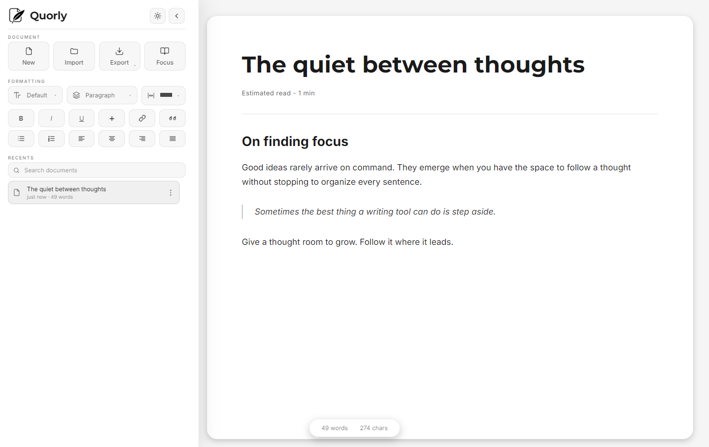

<p align="center">
  
</p>

<h1 align="center">Quorly</h1>

<p align="center">
  <strong>A private, offline writing space that lives in your browser.</strong><br>
  No account. No upload. No ads. No cookies.
</p>

<p align="center">
  <a href="https://quorly.dev/app/"><strong>Open the editor →</strong></a>
  &nbsp;·&nbsp;
  <a href="https://quorly.dev">quorly.dev</a>
  &nbsp;·&nbsp;
  <a href="https://quorly.dev/privacy/">Privacy</a>
</p>

<p align="center">
  <picture>
    <source media="(prefers-color-scheme: dark)" srcset="screenshots/editor-dark.png">
    <source media="(prefers-color-scheme: light)" srcset="screenshots/editor-light.png">
    
  </picture>
</p>

Quorly is a distraction-free text editor with just enough structure — headings, lists,
quotes, tables and images — plus five reading faces, a focus mode and a document library.
It opens in a tab, keeps working when the network disappears, and installs as an app.
There is no sign-up, no tour and nothing to set up first.

## What it does

| Writing | Keeping | Moving |
|---|---|---|
| Rich text, tables, images | Autosave as you type | Export to Markdown, PDF, plain text or `.quorly` |
| Focus mode, light and dark | A library of your last 10 documents | Import `.md`, `.html` or `.quorly` |
| Five reading faces, adjustable width | 20 versions per document | Write straight to disk via the file picker |
| Distraction-free by default | Your last document reopens within 48 hours | Print with its own light/dark theme |

## Your words stay on your device

| Where | What lives there |
|---|---|
| This browser, `localStorage` | The document you have open, written as you type |
| This browser, `IndexedDB` | The library: parked documents, their version history and images |
| Your disk, if you ask | A file you choose through the browser's own file picker |
| A server | Nothing — no title, no body, no image |

The editor makes exactly one kind of request: a same-origin `POST /e` when something
notable happens — a first keystroke, an export, a storage-quota error, a returning writer,
a WebMCP tool call. The endpoint accepts an event name from a fixed list and at most one
short property (an export format, a theme or a tool name). It carries no document content, no
identifier and no cookie, it answers `204`, and it fails silently by design, so a dropped
beacon can never interrupt writing.

Fonts, scripts, styles and icons are all served from this origin. The one third-party request
on the page is Cloudflare Web Analytics, which counts anonymous visits and sets no cookie;
`script-src` and `connect-src` allow that host and nothing else. No document content is ever
sent. The AI write-assist feature is absent from this build — there is no API call, no key
prompt and no model ID anywhere in the shipped code.

## Try it

1. Open **[quorly.dev/app](https://quorly.dev/app/)**. Start typing; it saves itself.
2. Install it if you want a window without a browser: Chrome and Edge offer an install icon
   in the address bar, Safari uses Share → Add to Home Screen.
3. On a fresh machine, open the same browser and your documents are already there. On a
   different one, export a `.quorly` file and import it.

## Run it locally

There is no build step, no package manager and no bundler — the site is plain HTML, CSS and
JavaScript. Serve the repository root over HTTP:

```sh
python -m http.server 8080      # or: npx serve .
```

Then open `http://localhost:8080/` for the landing page or `/app/` for the editor. Use HTTP
rather than opening `index.html` directly: the service worker, the file picker and the
install prompt all need a real origin.

## Layout

| Path | Purpose |
|---|---|
| `index.html`, `landing.css`, `landing.js` | Landing page at `/` |
| `app/index.html` | The editor at `/app/` |
| `app.js` | Editor behaviour |
| `stories.js` | Storage adapter: `localStorage` for the open document, `IndexedDB` for the library |
| `webmcp.js` | In-browser agent tools (WebMCP), registered only while the page is open |
| `styles.css` | Editor styles, including the mobile breakpoints |
| `sw.js` | Service worker — must stay at the root for scope `/` |
| `functions/e.js` | `POST /e`, the cookieless counter |
| `_headers` | CSP, MIME pins and caching |
| `smoke.mjs` | Post-deploy verification (not published) |
| `tools/release/` | Release runner (not published) |

Markdown is rendered by a vendored copy of `marked` and sanitised by `DOMPurify`; both are
pinned and byte-identical to their npm releases. The interface has no framework.

## How it ships

Deploys go through `tools/release/release.mjs`, never through a hand-built upload:

```sh
node tools/release/release.mjs run                     # snapshot -> gate -> preview -> prune
node tools/release/release.mjs run --dry-run           # the gate only, deploys nothing
node tools/release/release.mjs promote --commit <sha>  # production; manual, gated
```

A commit on `dev` builds a stage with `git archive` and runs the smoke suite against it
locally, then against the preview URL. `.gitattributes` marks `README.md`, `smoke.mjs`,
`.gitattributes`, `.assetsignore`, `.gitignore`, `.githooks/`, `tools/` and `screenshots/`
as `export-ignore`, so the archive contains exactly the deployable tree and nothing else.
Production is only ever moved by `promote`, which refuses a commit with no passing preview
on record and re-runs the suite against `https://quorly.dev` first.

Two environment variables matter, and neither is stored here: `CLOUDFLARE_API_TOKEN` for
deploying, and `CLOUDFLARE_ACCOUNT_ID` only for pruning old previews — the prune fails with
a clear message instead of guessing.

## Engineering notes

<details>
<summary><strong>A strict CSP with no inline anything</strong></summary>

`_headers` sets `script-src 'self'` with no `'unsafe-inline'`, which is only possible because
no document contains an inline `<script>`, an inline `<style>` or an inline event handler.
The JSON-LD block on the landing page is a data block, not executable script, so it needs no
exception. `manifest-src` and `worker-src` are named explicitly because both would otherwise
fall back to `default-src 'none'`, and the manifest is only fetched when a page becomes
installable — a failure that stays invisible until the service worker lands.

</details>

<details>
<summary><strong>Offline, without a cache that outlives a deploy</strong></summary>

`sw.js` uses network-first for HTML navigations so a deploy can never be masked by a stale
page, cache-first for `/fonts/*` (served `immutable`), and stale-while-revalidate for
everything else. A 4xx passes straight through, a 5xx falls back to the cache, and precaching
adds each URL independently so one bad file cannot leave the origin with no worker at all.
Only same-origin GETs are intercepted; the counter is never cached and never delayed.

</details>

<details>
<summary><strong>Two stores, on purpose</strong></summary>

The document you are looking at keeps its original synchronous `localStorage` keys, so the
first paint never waits on a database. The library — parked documents, their versions and
their images — lives in `IndexedDB`, because it holds far more than the 5 MB a string store
will take. Images are decoded, downscaled and re-encoded on the way in; nothing is deleted
before its replacement is durable, so an interrupted migration loses nothing.

</details>

<details>
<summary><strong>Agent tools in the browser</strong></summary>

`webmcp.js` registers ten tools against `document.modelContext` when the browser supports
WebMCP: read the document, list and open saved documents, create one, set its title, append
or replace content, insert a table, change reading preferences and delete a document. They
call the same functions the interface calls, destructive ones still ask for confirmation in
the page, and everything is torn down on `pagehide`. There is no server-side API.

</details>

<details>
<summary><strong>Machine-readable surfaces</strong></summary>

`/llms.txt`, `/index.md` and `/agent-skill.md` describe the site and the WebMCP tools for
agents; `/.well-known/ai-catalog.json` and `/.well-known/ard.json` point at that skill.
`robots.txt` names AI crawlers explicitly and carries `Content-Signal: ai-train=no`.

</details>

## Contact

`hello@quorly.dev`, or open an issue here.

---

The source is public for reference and search. No license is granted, and it is not open for
reuse or redistribution.
